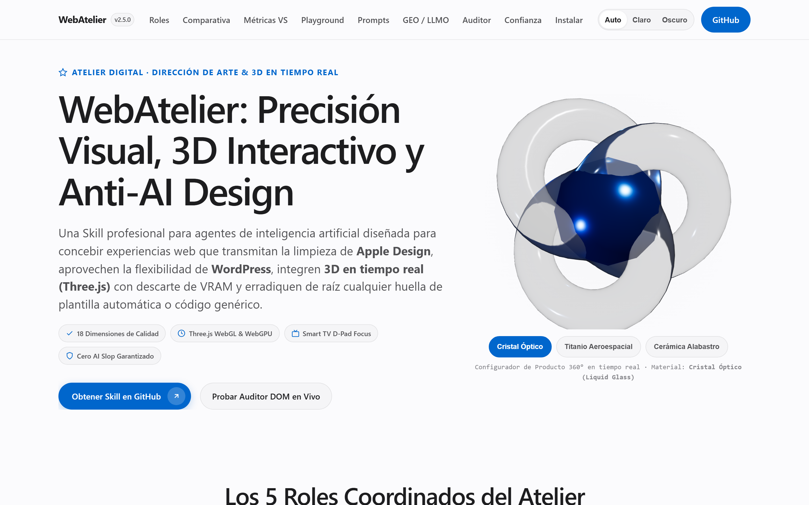
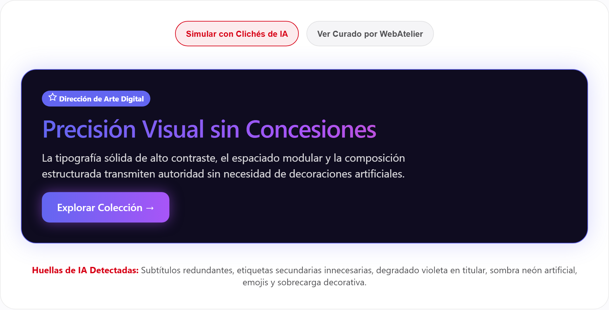
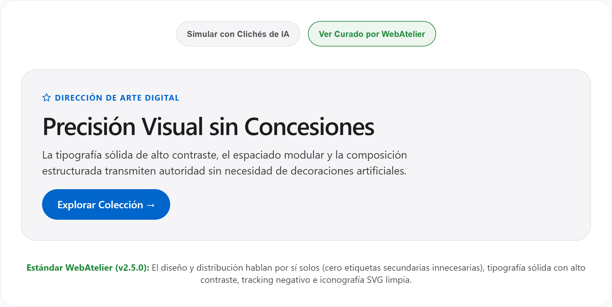
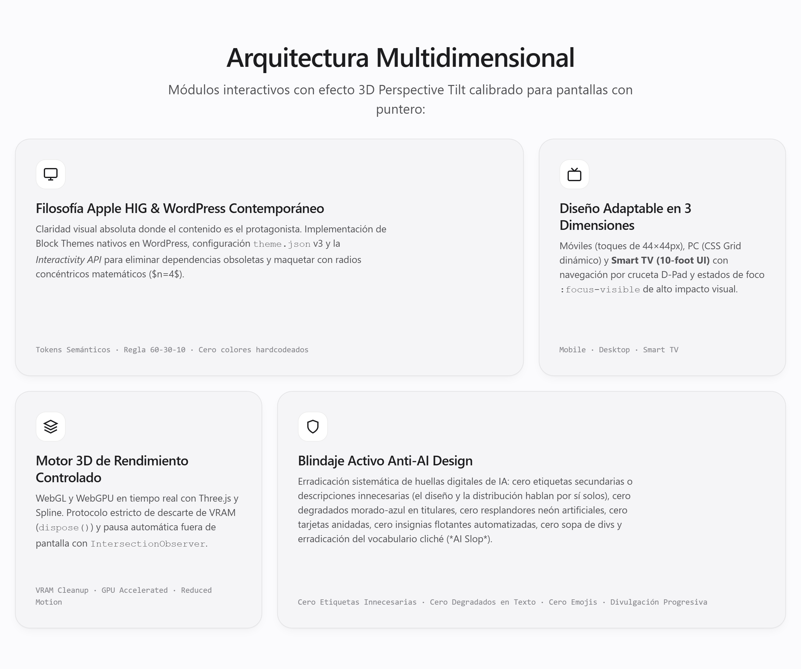
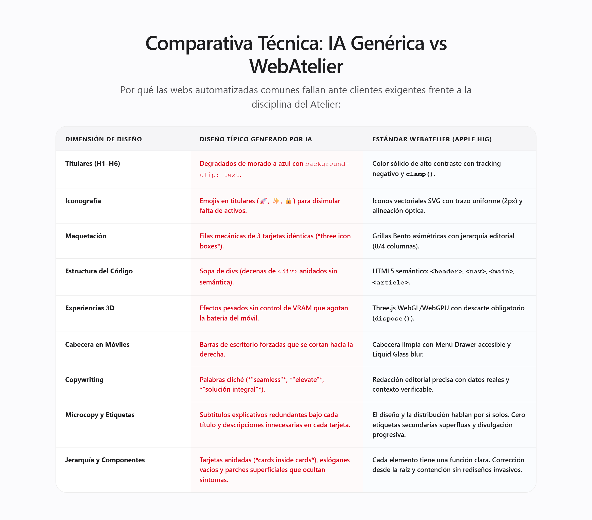
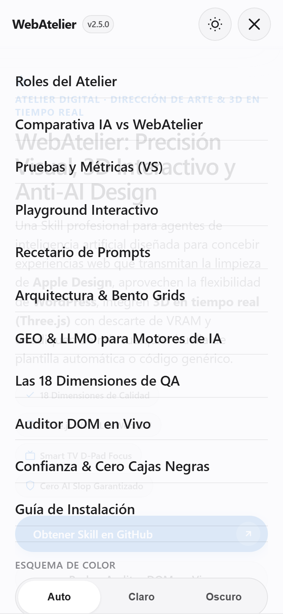

# WebAtelier · Digital Studio Skill for Premium Web Architecture

[](https://benjaminmurga.github.io/WebAtelier/)
[](https://github.com/BenjaminMurga/WebAtelier/releases)
[](https://merx.help/shield)
[](https://github.com/BenjaminMurga/WebAtelier/actions/workflows/anti-ai-quality-gate.yml)
[](LICENSE)
[-21759B.svg)](https://wordpress.org)
[](#)
[](#)
[](#)
[-FF9500.svg)](#)

> **Live Website / Demo en Vivo:** **[https://benjaminmurga.github.io/WebAtelier/](https://benjaminmurga.github.io/WebAtelier/)**  
> **Architect & Creator:** **Benjamin Murga** · [@BenjaminMurga](https://github.com/BenjaminMurga)  
> **Version:** 2.5.0  
> **Repository:** [https://github.com/BenjaminMurga/WebAtelier](https://github.com/BenjaminMurga/WebAtelier)  
> **Target:** Pi, Codex, Claude Code, Cursor, and Open Agent Ecosystems.

<p align="center">
  <a href="https://benjaminmurga.github.io/WebAtelier/">
    
  </a>
</p>

---

## English Overview 🇺🇸 / 🇬🇧

**WebAtelier** is an enterprise-grade agent skill designed to conceptualize, design, develop, and audit premium digital experiences. Inspired by high-end architectural studios, it combines the visual precision of **Apple Human Interface Guidelines**, the contemporary architecture of **WordPress (Block Themes / FSE / Headless)**, real-time 3D interactive experiences (**Three.js, WebGL/WebGPU, R3F, Spline**), universal responsive adaptation (**Mobile, PC, and Smart TV 10-foot UI**), strict **Anti-AI Design guardrails**, and cutting-edge **SEO, AEO, and GEO** optimization.

### Core Pillars
1. **Brainstorming & Creative Conception:** Guided discovery of visual vibe (Apple Minimalist, Swiss Typography, Nordic Organic, Warm Luxury), anti-cliché challenge, 3 execution paths (Spike, Bounded, Architectural), and strict hard-gates before implementation.
2. **Apple HIG Philosophy:** Clarity, Deference, Depth (*Liquid Glass*), spring physics (`cubic-bezier`), continuous curvature ($n=4$), and the 60-30-10 chromatic rule.
3. **Anti-AI Design Guardrails & UI Purity:** Automated eradication of AI fingerprints (purple-blue gradients, glow effects, single italicized words, emojis in headings, badges like "AI-Powered", div soup, and builder meta-tags). **Elimination of secondary labels and unnecessary descriptions: let the layout and spatial distribution speak for themselves.** Ban on nested card soup, empty slogans, and unneeded decorative clutter. Strict **Progressive Disclosure** (secondary details revealed only on demand) and **Design Containment** (maintain existing UI coherence without destructive full-page rewrites).
4. **Universal Responsive Design:** True 3-dimension screen support: Mobile/Tablet (0–767px, touch targets 44×44px, clean drawer menu), PC/Laptop (1024–1440px+, dynamic CSS Grid), and Smart TV (1080p/4K at 3m / D-Pad navigation with enhanced `:focus-visible`).
5. **Interactive 3D & Motion:** Real-time WebGL/WebGPU, Three.js with 360° product material configurator, mandatory VRAM disposal (`dispose()`), and GSAP ScrollTrigger respecting `prefers-reduced-motion`.
6. **Modern WordPress:** Full Site Editing (FSE), `theme.json` v3, Interactivity API, and strict PHP sanitization (`esc_html`, `wp_kses_post`).
7. **SEO, AEO, GEO & LLMO:** Schema.org JSON-LD, question-driven headers, verified executive summaries, Wikidata entity linking (`sameAs`), canonical `llms.txt`, and AI crawler permissions in `robots.txt`.

---

## Resumen en Español 🇨🇱 / 🇪🇸

**WebAtelier** es una Skill profesional y modular diseñada para agentes de IA y equipos de ingeniería digital. Inspirada en la artesanía y rigor de un taller de alta dirección de arte, permite concebir, diseñar, desarrollar y auditar sitios web de altísima gama combinando los principios de **Apple Design**, la arquitectura moderna de **WordPress**, experiencias 3D en tiempo real (**Three.js, WebGL/WebGPU, Spline**), diseño adaptable universal (**Móvil, PC y Smart TV**), blindaje estricto **Anti-AI Design** y optimización integral **SEO, AEO y GEO**.

### Pilares Fundamentales
1. **Brainstorming y Concepción Creativa de Atelier:** Calibración de identidad visual (Apple Minimalist, Editorial Suizo, Nordic Organic, Lujo Cálido), desafío anti-clichés de IA, clasificación en 3 caminos (Spike, Bounded, Architectural) y aprobación humana obligatoria (*Hard Gate*) antes de programar.
2. **Filosofía Apple HIG:** Claridad, Deferencia y Profundidad (*Liquid Glass* con `backdrop-filter: blur()`), física de resortes (*springs*), curvatura continua ($n=4$) y regla cromática 60-30-10.
3. **Blindaje Anti-AI Design y Pureza UI/UX:** Erradicación automatizada de huellas digitales de IA (degradados morado-azul, halos neón, palabras en cursiva solitaria, emojis en titulares, insignias "AI-Powered", sopa de divs y metaetiquetas de constructores). **Erradicación de etiquetas secundarias y descripciones innecesarias: deja que el diseño y la distribución de los elementos hablen por sí solos.** Prohibición de tarjetas anidadas superfluas (*card-in-card*), eslóganes vacíos y adornos sin propósito. **Divulgación progresiva estricta** (mostrar detalles secundarios solo bajo demanda) y **principio de contención** (priorizar eliminar o simplificar sin rediseñar páginas completas para cambios puntuales).
4. **Diseño Adaptable Universal en 3 Dimensiones:**
   * **Móviles/Tabletas (0px–767px):** Mobile-first, botones de 44×44px, cabecera limpia con Menú Drawer y cero dependencia de *hover*.
   * **PC/Laptops (1024px–1440px+):** CSS Grid dinámico, centrado óptico simétrico y navegación por cursor.
   * **Smart TV (10-foot UI a 3 metros):** Navegación exclusiva por D-Pad con foco `:focus-visible` aumentado y tipografía ampliada para lectura desde el sofá.
5. **Experiencias 3D e Interactivas:** WebGL/WebGPU, Three.js con configurador de producto 360°, protocolo estricto de liberación de VRAM (`dispose()`) y GSAP ScrollTrigger con `prefers-reduced-motion`.
6. **WordPress Contemporáneo:** Block Themes nativos, `theme.json` v3, Interactivity API y saneamiento riguroso.
7. **SEO, AEO, GEO y LLMO:** Marcado Schema.org JSON-LD, encabezados en formato de pregunta, resúmenes verificados, vinculación de entidades en Wikidata (`sameAs`), archivo canónico `llms.txt` y directivas en `robots.txt`.

---

## Repository Structure / Estructura del Repositorio

```text
WebAtelier/
├── .github/
│   └── workflows/
│       └── anti-ai-quality-gate.yml      # CI Quality Gate (GitHub Actions)
├── configs/
│   └── theme.json                         # WordPress FSE v3 theme configuration
├── references/
│   ├── accessibility-performance.md      # Universal Responsive (Mobile, PC, Smart TV), WCAG 2.2 AA
│   ├── aeo-geo.md                         # Answer Engine & Generative Engine Optimization, LLMO
│   ├── anti-ai-design.md                  # Comprehensive AI fingerprints catalog & prohibitions
│   ├── apple-design.md                    # Apple HIG, Liquid Glass, Squircle math, Spring Physics
│   ├── design-brainstorming.md            # Creative Conception, Brand Vibe Probing & Hard Gates
│   ├── design-system.md                   # Semantic token pairs, 60-30-10 rule, clamp() scales
│   ├── mobile-native-touch.md             # Mobile-native feel, 100dvh, safe-areas, input zoom fix
│   ├── motion-3d.md                       # Real-time 3D, WebGL/WebGPU, Three.js VRAM disposal
│   ├── quality-assurance.md               # 18-dimension rubric & CRITICAL_REJECT criteria
│   ├── seo.md                             # H1–H6 hierarchy, Schema.org JSON-LD templates
│   ├── source-inventory.md                # 54-source empirical audit & traceability matrix
│   ├── ui-polish-interactions.md          # Emil Kowalski UI polish, layered shadows, View Transitions
│   └── wordpress.md                       # Block Themes, Interactivity API, PHP sanitization
├── scripts/
│   ├── anti-ai-dom-auditor.js             # Automated DOM auditor for AI fingerprints
│   └── test-auditor.js                    # Automated unit test suite (npm test)
├── styles/
│   └── anti-ai-reset-and-tokens.css       # CSS tokens & heading gradient lock
├── .gitignore
├── LICENSE                                # MIT License (Benjamin Murga)
├── package.json                           # Node.js project manifest & validation scripts
├── README.md                              # Bilingual Documentation & Credits
└── SKILL.md                               # Agent Entrypoint & 10-Phase Workflow
```

---

## Visual Showcase & Anti-AI Benchmark / Galería Visual

### 1. El Impacto Visual: Clichés de IA vs. Estándar WebAtelier
Compara la diferencia inmediata entre la maquetación predecible de un generador común y la disciplina de alta dirección de arte de WebAtelier:

| ❌ Simulación con Clichés de IA (*AI Slop*) | ✅ Curado con WebAtelier (Apple HIG) |
| :---: | :---: |
|  |  |
| *Degradado violeta, sombra neón artificial, emojis en titulares y microcopy redundante.* | *Tipografía sólida de alto contraste, espaciado armónico y el diseño habla por sí solo.* |

### 2. Arquitectura de Grillas Bento Asimétricas y 3D
Estructuración en proporciones 8/4 con radios concéntricos matemáticos y material *Liquid Glass* (`backdrop-filter: blur`), erradicando filas monótonas de 3 cajitas iguales:

<p align="center">
  
</p>

### 3. Adaptabilidad Universal (Móviles y Escritorio)
Diseño concebido para navegación táctil ergonómica sin desbordamientos y menús drawer accesibles:

| Comparativa Técnica en Pantalla | Menú Drawer Móvil con Liquid Glass |
| :---: | :---: |
|  |  |

---

## What WebAtelier Does Exactly / ¿Qué Hace WebAtelier Exactamente?

WebAtelier acts as a coordinated team: **Digital Art Director + Senior WordPress Engineer + 3D/Motion Choreographer + Anti-AI Gate Auditor + GEO/SEO Consultant**. Here is what it executes depending on your prompt:

| Your Goal / Tu Objetivo | What WebAtelier Executes / Lo que Ejecuta la Skill | Primary Modules Used |
| :--- | :--- | :--- |
| **New Website / Landing Page** | Starts with **Creative Brainstorming** (Fase 1), establishes your brand vibe (Apple, Swiss, Nordic, Luxury), applies the 60-30-10 color rule, builds asymmetric Bento grids, and writes semantic HTML5 with zero AI clichés. | `design-brainstorming.md`<br>`apple-design.md`<br>`design-system.md` |
| **Audit an Existing Website** | Scans any URL in **4 real device viewports** (Mobile 375px, 414px, Tablet 768px, PC 1280px) using headless Chromium. Identifies text cuts, overflow bugs, and 19 AI fingerprints. | `audit-screen.js`<br>`anti-ai-design.md`<br>`quality-assurance.md` |
| **Clean Up AI-Slop / Redesign** | Strips purple-blue gradients from headings, removes emoji icons, fixes broken heading jumps (H1 $\rightarrow$ H4), replaces div soup with HTML5 semantic tags, and eliminates generic SaaS cards. | `anti-ai-design.md`<br>`anti-ai-dom-auditor.js`<br>`ui-polish-interactions.md` |
| **WordPress Block Themes / FSE** | Generates native Block Themes with `theme.json` v3, registers custom Block Patterns, implements the native WordPress *Interactivity API*, and applies strict PHP escaping (`esc_html`, `wp_kses_post`). | `wordpress.md`<br>`theme.json`<br>`accessibility-performance.md` |
| **3D & Interactive Experiences** | Integrates Three.js / WebGL / WebGPU scenes (such as real-time 360° product material configurators), 3D perspective card tilt, and guarantees VRAM cleanup (`dispose()`) and off-screen pause. | `motion-3d.md`<br>`landing-3d.js` |
| **Mobile-Native Touch Experience** | Solves the iOS 100vh toolbar jump (`100dvh`), kills grey tap flash, fixes sticky hover on touchscreens, eliminates iPhone input auto-zoom (16px base), and designs clean drawer menus. | `mobile-native-touch.md`<br>`accessibility-performance.md` |
| **Generative AI Visibility (GEO / LLMO)** | Optimizes your site so ChatGPT, Perplexity, Gemini, and Claude cite your content: creates `llms.txt`, permissive AI `robots.txt`, structured JSON-LD schemas, and Citable-First content. | `aeo-geo.md`<br>`llms.txt`<br>`robots.txt` |

---

## Reference Modules Deep-Dive / Los 13 Módulos de Referencia

When an agent loads WebAtelier, it queries these modules via **progressive disclosure** as needed:

1. **`references/design-brainstorming.md`:** 4-dimension discovery (purpose, visual vibe, 3D level, screen factors), Anti-AI Cliché Challenge, and hard-gates before implementation.
2. **`references/apple-design.md`:** Apple HIG philosophy (Clarity, Deference, Depth), squircle math ($n=4$), continuous curvature, concentric radii ($R_{inner} = R_{outer} - \text{Padding}$), and spring physics.
3. **`references/anti-ai-design.md`:** Full catalog of 19 AI fingerprints, strict heading gradient bans, and automated DOM audit criteria.
4. **`references/mobile-native-touch.md`:** Mobile-native platform fixes: `100dvh`, iOS safe area insets, tap highlight elimination, sticky hover gates, and input zoom fixes.
5. **`references/ui-polish-interactions.md`:** Emil Kowalski's design engineering framework: Before/After review rubric, layered ambient multi-stop shadows, button-in-button nested architecture, and native View Transitions API.
6. **`references/design-system.md`:** Inseparable semantic token pairs, strict 60-30-10 chromatic rule, `clamp()` fluid scales, and widescreen optical centering rules.
7. **`references/motion-3d.md`:** Real-time 3D architecture (WebGL/WebGPU, Three.js, R3F, Spline), 360° product configurators, VRAM disposal (`dispose()`), and ScrollTrigger with `prefers-reduced-motion`.
8. **`references/accessibility-performance.md`:** Universal Responsive across 3 dimensions (Mobile 44px, PC grid, Smart TV D-Pad focus), WCAG 2.2 AA checklists, and video embed facade patterns.
9. **`references/wordpress.md`:** Native Full Site Editing (FSE), `theme.json` v3, Block Patterns registration, Interactivity API, and template debt elimination.
10. **`references/seo.md`:** Strict H1–H6 sequential hierarchy, Schema.org JSON-LD templates (`NewsArticle`, `BreadcrumbList`, `Organization`), and taxonomy hygiene.
11. **`references/aeo-geo.md`:** Answer Engine & Generative Engine Optimization (GEO/LLMO): `llms.txt`, AI bot `robots.txt`, Citable-First 2–4 sentence answers, and Wikidata `sameAs` entity reconciliation.
12. **`references/quality-assurance.md`:** 18-dimension evaluation rubric and CRITICAL_REJECT acceptance criteria.
13. **`references/source-inventory.md`:** Empirical evidence base analyzing 54 real-world production web sources and documented anti-patterns.

---

## Prompt Cookbook / Recetario de Prompts para tu Agente

Copy and paste these exact prompts into **Pi, Cursor, Claude Code, or Codex** to unleash WebAtelier:

### 1. Diseñar una Landing Page Editorial desde Cero
> *"Actúa bajo la Skill WebAtelier. Inicia con la Fase 1 de Brainstorming para conceptualizar una landing page de alta gama para [tu proyecto/producto]. Calibra el universo estético entre Minimalismo Apple y Editorial Suizo, define la regla 60-30-10 y preséntame la especificación de diseño antes de escribir código."*

### 2. Auditar y Eliminar Huellas de IA de una Web Existente
> *"Usa WebAtelier para auditar esta página web [HTML o URL]. Revisa las 19 huellas de IA (degradados en titulares, emojis en H1, sopa de divs, badges artificiales), ejecuta la herramienta `scripts/audit-screen.js` en 4 pantallas para verificar que no haya desbordamiento horizontal y entrégame la versión refactorizada."*

### 3. Crear un Componente o Tema para WordPress FSE
> *"Bajo las directrices de WebAtelier, crea un Block Pattern de Gutenberg para una grilla Bento asimétrica (8/4 columnas) utilizando tokens de `theme.json` v3, radios concéntricos matemáticos y la Interactivity API para el filtrado en el cliente sin recargar la página."*

### 4. Optimizar una Web para Motores de IA (GEO & LLMO)
> *"Aplica las directrices GEO/LLMO de WebAtelier a mi sitio web: genera el archivo `llms.txt` canónico en Markdown, configura las reglas de `robots.txt` para GPTBot y PerplexityBot, estructura el contenido con la regla Citable-First y añade marcado JSON-LD con Wikidata sameAs."*

---

## Engineering Work Style & UI/UX Principles (v2.5.0) / Estilo de Trabajo y Principios UI/UX

WebAtelier v2.5.0 codifica un contrato riguroso de ingeniería y diseño para que los agentes razonen con criterio arquitectónico:

### 🛠️ Estilo de Trabajo (Engineering Mindset)
* **Principios Fundamentales Primero:** Confirma el objetivo real, las restricciones técnicas y los criterios de éxito antes de empezar cualquier desarrollo.
* **Corrección de Raíz:** Soluciona las anomalías desde su causa origen; nunca apliques parches superficiales que solo oculten los síntomas.
* **Trazabilidad en `HANDOFF.md`:** Registra errores, incidentes y aprendizajes en `HANDOFF.md` y consúltalo antes de comenzar cada nueva tarea.
* **Presupuesto de Rendimiento:** En desarrollos para producción, evalúa y controla el costo de rendimiento (VRAM, CPU, peso del DOM, transferencias) tanto en la fase de diseño como en los criterios de aceptación.

### 🎨 UI/UX — Pureza Visual y Erradicación de Clichés de IA
* **El diseño habla por sí solo:** Evita las etiquetas secundarias y las descripciones innecesarias. Deja que el diseño y la distribución de los elementos hablen por sí solos.
* **Función clara por elemento:** Cada elemento debe cumplir una función clara para el usuario: evita eslóganes vacíos, elementos decorativos superfluos, tarjetas anidadas (*cards-inside-cards*) e información repetida.
* **Divulgación Progresiva (*Progressive Disclosure*):** Muestra explicaciones solo para situaciones anormales o acciones obligatorias. Coloca los detalles secundarios detrás de mecanismos de divulgación progresiva (muéstralos únicamente cuando sean necesarios).
* **Coherencia y Contención:** Mantén la coherencia con las pantallas existentes. Prioriza eliminar o simplificar elementos antes que agregar otros nuevos. No rediseñes toda la página para modificar una sola parte.

---

## Trust & Auditability / Confianza y Auditoría Previa

> *"Being able to read the skill before it touches a project is the part that matters for trust."*  
> — **[@PublicAI_](https://x.com/PublicAI_)** on X

### English 🇺🇸 / 🇬🇧
WebAtelier is engineered around a **100% transparent, inspect-first architecture**:
* **Zero Black Boxes:** Everything the agent executes is governed by plain Markdown files (`SKILL.md` and the 13 reference modules in `references/`). No compiled binaries, no obfuscated telemetry, and no hidden prompt injections.
* **Independent Security Audit (Grade: A+ Verified Safe):** Audited by AgentShield against the Cloudflare Security Audit Specification (AI & LLM) and OWASP LLM Top 10 — certified 0 prompt injections, 0 tool-argument sink injections, 0 credential leak vectors, and verified MCP trust boundaries.
* **Deterministic Guardrails:** Prohibitions (e.g. banning purple gradients, single italic words, or missing mobile touch targets) are codified as verifiable criteria and open-source scripts (`scripts/anti-ai-dom-auditor.js`).
* **Non-Destructive by Default:** WebAtelier prioritizes read-only analysis and creative brainstorming (Phase 1) with explicit human confirmation gates before modifying or writing code in your workspace.

### Resumen en Español 🇨🇱 / 🇪🇸
WebAtelier está diseñada bajo una **arquitectura 100% transparente y auditable**:
* **Cero Cajas Negras:** Todo lo que ejecuta el agente está gobernado por archivos Markdown legibles (`SKILL.md` y los 13 módulos de referencia en `references/`). Sin binarios compilados, sin telemetría opaca y sin inyecciones de prompts ocultas.
* **Auditoría de Seguridad Independiente (Calificación A+ Verificada):** Auditada por AgentShield contra las especificaciones de seguridad Cloudflare AI y el OWASP LLM Top 10 — certificando 0 inyecciones de prompts, 0 sumideros de ejecución insegura, 0 vectores de fuga de credenciales y fronteras de confianza verificadas.
* **Límites Deterministas:** Las prohibiciones (ej. degradados morados en titulares, cursivas aisladas o elementos táctiles inferiores a 44px) están codificadas en criterios verificables y scripts de código abierto (`scripts/anti-ai-dom-auditor.js`).
* **No Destructivo por Defecto:** WebAtelier prioriza el análisis de sólo lectura y la concepción creativa (Fase 1) con filtros obligatorios de aprobación humana antes de modificar o crear código en el espacio de trabajo.

---

## Installation & Usage / Instalación y Uso

### 1. Claude Code
Instala WebAtelier en tu entorno global o por proyecto / Install into your workspace or global environment:

**Global (disponible en todos tus proyectos / across all projects):**
```bash
git clone https://github.com/BenjaminMurga/WebAtelier.git ~/.claude/skills/web-atelier
# or via the shared agent skills directory / o vía directorio compartido de agentes:
git clone https://github.com/BenjaminMurga/WebAtelier.git ~/.agents/skills/web-atelier
```

**Por Proyecto / Per Project (workspace-local):**
```bash
# Dentro de la raíz de tu proyecto / Inside your project root:
git clone https://github.com/BenjaminMurga/WebAtelier.git .claude/skills/web-atelier
```

### 2. Pi, Codex, Cursor & Open Agent Ecosystems
Para Pi, Codex, Cursor o cualquier arnés compatible con Agent Skills / For any harness supporting Agent Skills:

```bash
# Clonar directamente en el directorio estándar de skills / Clone to standard skills dir:
git clone https://github.com/BenjaminMurga/WebAtelier.git ~/.agents/skills/web-atelier

# O copiar desde un clon local / Or copy from a local clone:
cp -r WebAtelier ~/.agents/skills/web-atelier
```

The agent will automatically discover **`web-atelier`** and consult the `references/` directory via progressive disclosure based on the user's task.  
*(El agente detectará automáticamente **`web-atelier`** y consultará los módulos en `references/` mediante divulgación progresiva).*

### 3. Universal Setup & Screen Audit / Instalación y Auditoría Visual

Cualquier usuario que clone este repositorio puede ejecutar la suite completa con Node.js o Bun:

```bash
# 1. Clonar e ingresar
git clone https://github.com/BenjaminMurga/WebAtelier.git
cd WebAtelier

# 2. Instalar dependencias opcionales de Playwright
npm install

# 3. Descargar el motor Chromium headless (para capturas y medidas reales)
npx playwright install chromium

# 4. Auditar la pantalla en 4 factores de forma en tiempo real:
npm run audit:screen

# 5. Auditar cualquier sitio web en producción:
node scripts/audit-screen.js https://sitio-de-tu-cliente.com

# 6. Ejecutar tests del auditor Anti-AI:
npm test

# 7. Actualizar la Skill cuando se publiquen mejoras en GitHub:
npm run update
# o directamente:
git pull origin main
```

---

## 10-Phase Operating Workflow / Flujo Operativo de 10 Fases

1. **Fase 1: Comprensión & Brainstorming de Atelier (Creative Conception):** Scope, audience, brand vibe calibration (Apple, Swiss, Nordic, Luxury), anti-cliché challenge, 3 execution paths (Spike, Bounded, Architectural), and strict hard-gate before code.
2. **Fase 2: Investigación (Research):** Query `references/source-inventory.md` and related modules.
3. **Fase 3: Dirección de Arte (Art Direction):** Semantic tokens, 60-30-10 rule, original composition.
4. **Fase 4: Arquitectura (Architecture):** HTML5 semantic markup (no div soup), FSE templates.
5. **Fase 5: Diseño (Design System):** Bento grids, fluid typography with `clamp()`, concentric radii ($n=4$).
6. **Fase 6: Desarrollo (Development):** Native Block Themes, Interactivity API, strict PHP escaping.
7. **Fase 7: Motion & 3D:** GSAP timelines, Three.js scenes with VRAM disposal, `prefers-reduced-motion`.
8. **Fase 8: Optimización (Optimization):** Schema.org, Wikidata, Core Web Vitals, D-Pad/keyboard accessibility.
9. **Fase 9: Auditoría Anti-AI (Anti-AI Gate):** Automated DOM check with `anti-ai-dom-auditor.js`.
10. **Fase 10: Validación y Entrega (QA & Delivery):** Evaluation against the 18-dimension rubric.

---

## Credits & Authorship / Créditos y Autoría

* **Author / Autor:** **Benjamin Murga**
* **GitHub Profile / Perfil de GitHub:** [@BenjaminMurga](https://github.com/BenjaminMurga)
* **Contact / Contacto:** `benjamin.a.murga@gmail.com`
* **Community Recognition / Reconocimiento Comunitario:** Special thanks to [@PublicAI_](https://x.com/PublicAI_) on X for insightful feedback regarding skill transparency and auditability. *(Agradecimiento especial a @PublicAI_ por su valiosa retroalimentación sobre transparencia y auditabilidad).*
* **License / Licencia:** [MIT License](LICENSE)
